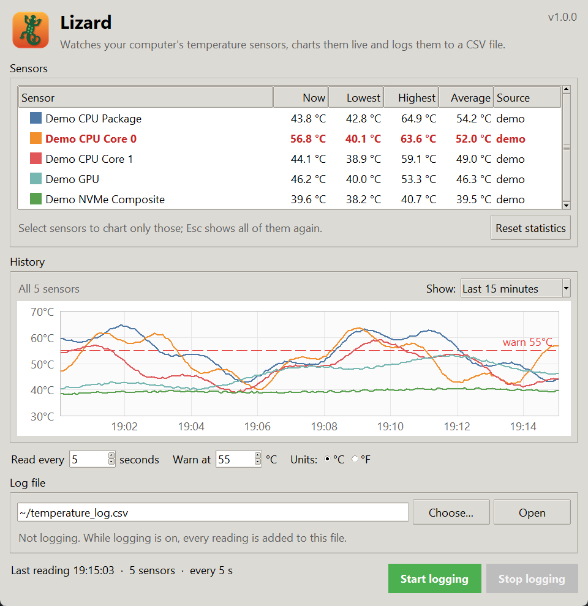

# Lizard user guide

Lizard shows the temperature of every sensor in your Linux computer, charts how
it changes, and can log every reading to a CSV file. It only ever **reads**
sensors; it doesn't change fan speeds or any other setting, and needs no root
access.

## The window



The header shows the version of Lizard you are running (top right).

### Sensors

One row per sensor:

| Column  | Meaning                                                                         |
|---------|---------------------------------------------------------------------------------|
| Sensor  | The sensor's name, with a color swatch matching its line in the chart           |
| Now     | The latest reading                                                              |
| Lowest  | The lowest reading since Lizard started (or since **Reset statistics**)         |
| Highest | The highest reading since then                                                  |
| Average | The average of every reading since then                                         |
| Source  | Where the reading comes from: `hwmon`, `thermal zones`, `nvidia-smi`, or `demo` |

- A row turns **red and bold** when the sensor is at or above the warning temperature.
- A row turns **grey** with a dash in **Now** when the latest reading didn't include
  that sensor, for example a GPU that powered down or a USB drive that was removed.
- **Reset statistics** forgets the lowest, highest and average values and clears
  the chart. Handy right before a stress test or a game.

Names are built from the driver and the sensor's own label, e.g. `CPU Package id 0`,
`CPU Core 3`, `NVMe Composite` or `GPU junction`. Sensors without a label are numbered
the way the kernel numbers them (`ACPI temp1`). When two sensors would get the same
name, such as two NVMe drives, the second is called `NVMe Composite (2)`.

### History

A chart of the readings. Use **Show** to pick the last 5 minutes, 15 minutes or hour.

- **Select rows** in the sensor table to chart only those sensors. Ctrl-click
  adds or removes one row, Shift-click selects a range. **Esc** (with the table
  focused) shows all sensors again.
- The **dashed red line** is the warning temperature. It appears once a sensor
  gets close enough to it to fit on the same scale.
- A line breaks where readings are missing, e.g. while a source was failing.
- The vertical scale adapts to the readings shown and always spans at least 10 °C,
  so a steady sensor isn't drawn as a wild zig-zag.

### Options

| Option     | What it does                                                                           |
|------------|----------------------------------------------------------------------------------------|
| Read every | How often the sensors are read, in seconds (1–3600). Applies to the chart and the log. |
| Warn at    | The temperature at which sensors are highlighted (20–150 °C).                          |
| Units      | Show °C or °F. The log file always records °C.                                         |

Type a value and press **Enter**, or use the arrows. A new interval takes effect at once.

### Log file

- **Choose…** picks the file to log to. If it already exists, new readings are
  added to the end; nothing is overwritten. The default is `~/temperature_log.csv`.
- **Open** opens the file in your default application for CSV files.
- The line below shows whether Lizard is logging, since when, and how many rows
  it has written in this session.

### Start logging / Stop logging

While logging is on, every reading is appended to the log file and saved
immediately. If writing fails (disk full, USB stick removed…), logging stops and
Lizard tells you why. Closing the window while logging asks for confirmation first.

### Status line

The bottom left shows when the sensors were last read, how many there are and how
often they are read. If a source fails, an orange ⚠ line says which one and why;
the other sources keep working.

## Which sensors you'll see

Lizard reads the same kernel interface as `lm-sensors`, so `sensors` and Lizard
show the same temperatures (Lizard doesn't need `sensors` to be installed).

| Hardware                    | Appears as                            | Comes from                                    |
|-----------------------------|---------------------------------------|-----------------------------------------------|
| Intel CPU                   | `CPU Package id 0`, `CPU Core 0`, …   | hwmon `coretemp`                              |
| AMD CPU                     | `CPU Tctl`, `CPU Tccd1`, …            | hwmon `k10temp`                               |
| NVMe SSD                    | `NVMe Composite`, `NVMe Sensor 1`     | hwmon `nvme`                                  |
| SATA drive                  | `Drive temp1`                         | hwmon `drivetemp` (`sudo modprobe drivetemp`) |
| AMD GPU                     | `GPU edge`, `GPU junction`, `GPU mem` | hwmon `amdgpu`                                |
| NVIDIA GPU (open `nouveau`) | `GPU temp1`                           | hwmon `nouveau`                               |
| NVIDIA GPU (proprietary)    | `NVIDIA GeForce RTX …`                | `nvidia-smi`                                  |
| Raspberry Pi and other ARM  | `CPU temp1`                           | hwmon `cpu_thermal`, or thermal zones         |
| Motherboard                 | `ACPI temp1`, `nct6775 …`, `it87 …`   | hwmon `acpitz`, Super I/O drivers             |

Drivers Lizard doesn't know are shown under their own name. Thermal zones are only
used when hwmon reports no temperatures at all, because they mostly repeat it.

### Not seeing a sensor?

- **Motherboard sensors** (Super I/O chips) often need a driver to be loaded. Run
  `sudo sensors-detect` from the `lm-sensors` package once and follow its advice,
  then restart Lizard.
- **SATA drives** need the `drivetemp` module: `sudo modprobe drivetemp`, and add
  `drivetemp` to `/etc/modules-load.d/drivetemp.conf` to load it at boot.
- **NVIDIA GPUs** on the proprietary driver need `nvidia-smi` on the `PATH`. Test it
  with `nvidia-smi --query-gpu=name,temperature.gpu --format=csv`.
- **Virtual machines and containers** usually have no sensors at all: the hardware
  belongs to the host. Lizard then says "No temperature sensors found". Use
  `lizard --demo` to try the app with simulated sensors.
- `lizard-log --list` prints every sensor Lizard can read, which is a quick way to
  check from a terminal.

## Logging without a window: `lizard-log`

`lizard-log` reads the sensors on a timer, prints each round and appends it to the log:

```text
$ lizard-log -i 10
Logging every 10 s to /home/you/temperature_log.csv. Press Ctrl+C to stop.
2026-10-25 19:15:03  CPU Package id 0 52.0 °C  ·  CPU Core 0 49.0 °C  ·  NVMe Composite 38.9 °C
```

| Option                  | Meaning                                                 |
|-------------------------|---------------------------------------------------------|
| `-i`, `--interval SECS` | Time between readings (default 5, minimum 1)            |
| `-o`, `--log-file PATH` | CSV file to append to (default `~/temperature_log.csv`) |
| `--no-log`              | Only print the readings                                 |
| `-n`, `--count N`       | Stop after N readings instead of running until Ctrl+C   |
| `-q`, `--quiet`         | Don't print the readings (warnings are still printed)   |
| `--list`                | List the sensors found and exit                         |
| `--demo`                | Use simulated sensors                                   |
| `--version`             | Show the version and exit                               |

It exits with status 1 if no sensors are found or the log can't be written.

### Running it as a service

`packaging/linux/lizard-log.service` is a systemd **user** service that logs every
10 seconds to `~/temperature_log.csv`:

```bash
mkdir -p ~/.config/systemd/user
cp packaging/linux/lizard-log.service ~/.config/systemd/user/
systemctl --user daemon-reload
systemctl --user enable --now lizard-log
systemctl --user status lizard-log     # is it running?
journalctl --user -u lizard-log        # its warnings
```

The service expects `lizard-log` in `~/.local/bin`, where `pipx install .` and
`pip install --user .` put it. If yours is elsewhere (`command -v lizard-log`
tells you), edit `ExecStart` in the copied file. User services stop when you log
out unless you enable lingering: `sudo loginctl enable-linger "$USER"`.

## The log file

```text
timestamp,sensor,temperature_c
2026-10-25 19:15:03,CPU Package id 0,52.0
2026-10-25 19:15:03,CPU Core 0,49.0
2026-10-25 19:15:08,CPU Package id 0,53.0
```

- One row per sensor per reading, so sensors can come and go without breaking the file.
- `timestamp` is local time, `YYYY-MM-DD HH:MM:SS`. Temperatures are °C with one decimal.
- UTF-8, comma-separated, with a header line when the file is created.
- The window and `lizard-log` use the same format, so they can share a file (but
  don't log from both at once, or rows will be interleaved).

To get one column per sensor in a spreadsheet, use a pivot table with `timestamp`
as rows, `sensor` as columns and `temperature_c` as values. In Python:

```python
import pandas as pd
log = pd.read_csv("temperature_log.csv", parse_dates=["timestamp"])
wide = log.pivot_table(index="timestamp", columns="sensor", values="temperature_c")
```

## Settings

The window remembers the interval, warning temperature, units, chart range and log
file in `~/.config/lizard/settings.json` (or under `$XDG_CONFIG_HOME` if set). They
are saved when you close the window. Delete the file to go back to the defaults.
Logging always starts switched off.

## Troubleshooting

| Problem                                          | What to do                                                                                            |
|--------------------------------------------------|-------------------------------------------------------------------------------------------------------|
| `ModuleNotFoundError: No module named 'tkinter'` | Install Tkinter: `sudo apt install python3-tk` (see the README for other distributions).              |
| "No temperature sensors found"                   | See [Not seeing a sensor?](#not-seeing-a-sensor). In a VM this is expected; try `--demo`.             |
| ⚠ `nvidia-smi: …` in the status line             | The NVIDIA driver isn't responding, often right after a driver update. Rebooting usually fixes it.    |
| "Can't start logging"                            | The folder isn't writable or doesn't exist on a removable drive. Choose another file.                 |
| The window or text is tiny on a high-DPI screen  | Tk follows the X server's DPI. Set it with `xrdb` (`Xft.dpi: 144`) or your desktop's scaling setting. |
| Lizard isn't in the application menu             | Run `packaging/linux/install-desktop-entry.sh` (it needs the `lizard` command to be installed).       |
